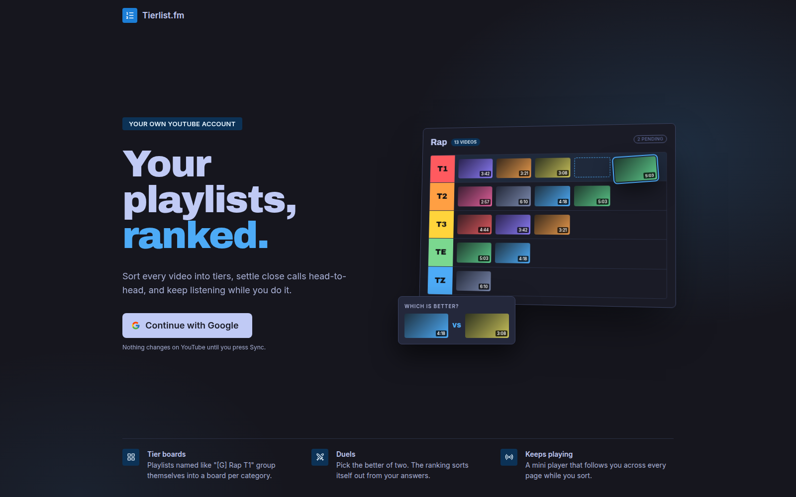

<div align="center">

# Tierlist.fm

**Your YouTube playlists, ranked.**

Sort every song into tiers, settle close calls head-to-head, and keep listening while you do it -
on top of the YouTube account you already have. Self-hosted, free for personal use.

[](LICENSE)




</div>

## Why

A YouTube playlist is a flat list. After a few hundred songs, "which of these do I actually
love?" has no answer - you can't rank, you can only scroll.

Tierlist.fm turns your playlists into a **tier list**: `S` for the songs you'd defend to the
end, down to `D` for the ones you're keeping out of habit (or name the tiers whatever you
like). The tiers **are** YouTube playlists (`Rap S`, `Rap A`, ...), so nothing is locked
into this app - rank here, and
every YouTube / YouTube Music device you own plays the result.

## Features

**Tier boards** - Playlists named by your template (`Rap S` ... `Rap D`) group themselves
into one board per category. The whole board fits on one screen as album-art tiles; drag a
song between tiers, or onto the always-visible Tier Rail. Boards you've opened are kept on
your device, so even one with hundreds of songs opens instantly while the fresh copy loads
from YouTube in the background.

**Duels** - Hear two songs' hooks back to back and say which hits harder (clearly, a bit, or
too close). Every verdict feeds a hidden score; the app picks the duels that settle the most
among your ranked songs and suggests a tier move only once the evidence is overwhelming - you
approve each one, then push to YouTube as usual. To-do songs stay out of duels: you place those.

**A player that never stops** - A YouTube-Music-style player with a real queue (play next,
add to queue, shuffle, repeat). Minimize it to a mini bar or a floating corner; it keeps
playing as you move between boards, and you can rate the playing song with `Shift+1-5`.

**To-do triage** - Save new songs to a `TODO` playlist on your phone, then play the TODO row: it
plays them one by one, and rating the current song files it and moves on to the next.

**Add songs by link** - Paste one or more YouTube / YouTube Music links anywhere (`Ctrl+V`);
the board is guessed from the artist, and one key puts the song in a tier.

**Safe by design** - Every edit is staged locally with undo (`Ctrl+Z`, 50 steps). Nothing
changes on YouTube until you press **Push to YouTube**, which adds the video to its new
playlist *before* removing it from the old one. Duplicate copies across tiers are cleaned up
automatically.

**Keyboard-first** - Command palette (`Ctrl+K`), Vimium-style navigation (`f` link hints,
`g h` home, `/` search), and a shortcut for nearly everything (`?` lists them).

**Yours to style** - 6 themes (Tokyo Night, Dracula, Solarized Light, ...), 8 accents, 3
tier palettes. Settings follow your Google account to any browser.

**Private by default** - Only playlists that match your naming template ever appear in the
app; everything else in your account stays invisible.

The full list, page by page, is in [docs/features.md](docs/features.md).

<!-- Screenshots of the signed-in app. Save them in docs/screenshots/ and uncomment:

## Screenshots

| Tier board | Duel |
|---|---|
|  |  |
| **Player & queue** | **Settings** |
|  |  |
-->

## How it works

Your **naming** (Settings -> Playlist naming) decides which playlists are tiers: a
template with `{category}` and `{tier}`, plus the names of your five tiers and your to-do
list. Anything else in `{braces}` is a token of your own - kept as-is when renaming.

| Template | Tier names | Matches |
|---|---|---|
| `{category} {tier}` (default) | `S A B C D` (default) | `Rap S`, `Lo-fi D` |
| `{category} - {tier}` | `Gold Silver Bronze Meh Skip` | `Rap - Gold` |
| `[{my_label}] {category} {tier}` | `1 2 3 4 5` | `[Chill] Rap 1` |

Each board also gets an unranked to-do list (`Rap TODO`, or whatever you call it). The
app auto-detects the naming that fits your existing playlists, and can rename them all on
YouTube if you change it (with a preview and a quota estimate first). Create a new board
from Home -> **New tier list**.

## Self-host it

You need Docker and a Google Cloud project (free) for the YouTube API.

### 1. Google OAuth credentials

1. In the [Google Cloud Console](https://console.cloud.google.com/), create a project.
2. Enable the **YouTube Data API v3** (APIs & Services -> Library).
3. Set up the consent screen (Google Auth Platform -> **Audience**): user type *External*, and
   add every Google account that will log in under **Test users**. Under **Data access**, add
   the scopes `openid`, `profile` and `.../auth/youtube.force-ssl` (read/write - needed to move
   songs between playlists).
4. **Clients -> Create client**: type *Web application*, authorized redirect URI
   `<TIERLIST_URL>/login/oauth2/code/google` - for the default local install that's
   `http://localhost/login/oauth2/code/google`.
5. Copy the **Client ID** and **Client Secret**.

### 2. Configure

```bash
cp .env.example .env
```

`.env.example` is the whole configuration, commented. The ones to set:

- `GOOGLE_CLIENT_ID`, `GOOGLE_CLIENT_SECRET` - from step 1.
- `TIERLIST_URL` - the address you'll open it at, e.g. `http://localhost:8080` or
  `https://tierlist.example.com` (no trailing slash; with a sub-path if you set
  `TIERLIST_BASE_PATH` - see "Behind a reverse proxy"). Google's redirect URI must be
  this plus `/login/oauth2/code/google`.
- `TIERLIST_PORT` - the host port (default `80`). It's the only port the app opens:
  the backend and Postgres stay inside Compose's network.
- `DB_PASSWORD` - before the first start (it's fixed when the database is created).
- `PUID` / `PGID` - your `id -u` / `id -g`, so backup files are yours.

### 3. Run

```bash
docker compose up -d --build
```

Open your `TIERLIST_URL` (**http://localhost** by default) and continue with Google. That's it - Postgres (for your settings)
comes up alongside, and the schema is created on first start.

On Google's consent screen, **tick the YouTube permission** - if it's left unticked, the app
can't read your playlists and tells you to log in again.

Want it as a desktop app? In Chrome or Edge, click the install icon in the address bar
(or menu -> *Install Tierlist.fm*) - it opens in its own window with its own icon.

### Where your data lives

- **Database** - the `pgdata` Docker volume (`tierlistfm_pgdata`). Set `DB_DATA_LOCATION`
  to a path (e.g. `./pgdata`) to keep it in a host folder instead; a bare name stays a
  named volume. Changing it later doesn't move existing data - restore a backup into it.
- **Backups** - `./backups/`, or the folder in `BACKUP_LOCATION`.
- Your playlists themselves live on YouTube; the database holds settings and duel history.

### Updating

```bash
git pull && docker compose up -d --build
```

Migrations run on start. Restarting the backend logs everyone out (sessions are in memory).

### Behind a reverse proxy

Point the proxy (Caddy, Traefik, nginx, ...) at the `frontend` container's port 80 (or
`TIERLIST_PORT` on the host) and set `TIERLIST_URL` to the public `https://` address. The
proxy must pass the original `Host` header and `X-Forwarded-Proto` (all common ones do) -
the backend builds Google's redirect URI from them. Everything (the app, `/api/`, Google
login) is on that one origin, so nothing else needs routing.

To serve it under a sub-path (e.g. `https://example.com/tierlist.fm/`), set
`TIERLIST_BASE_PATH=/tierlist.fm` and include it in `TIERLIST_URL`
(`https://example.com/tierlist.fm`); Google's redirect URI is then
`https://example.com/tierlist.fm/login/oauth2/code/google`. The reverse proxy in front
must strip this prefix before forwarding and send `X-Forwarded-Prefix: <prefix>`
(Traefik's StripPrefix middleware does both). Rebuild the frontend after changing it
(`docker compose up -d --build`). The login cookie is scoped to the sub-path, so other
apps on the same host don't clash with it.

### Upgrading from an older `.env`

Old setting names still work when the new one isn't set, so an existing `.env` and
database keep working after a `git pull`: `FRONTEND_URL` -> `TIERLIST_URL`,
`FRONTEND_PORT` -> `TIERLIST_PORT`, `POSTGRES_DB` / `POSTGRES_USER` / `POSTGRES_PASSWORD`
-> `DB_DATABASE_NAME` / `DB_USERNAME` / `DB_PASSWORD`, `BACKUP_UID` / `BACKUP_GID` ->
`PUID` / `PGID`. One change needs action: Google login now goes through the app's own
address instead of the backend's port `48123` (which is no longer published), so add
`<TIERLIST_URL>/login/oauth2/code/google` (e.g. `http://localhost/login/oauth2/code/google`)
to your Google client's redirect URIs. `SERVER_PORT` and `VITE_API_BASE` are no longer
needed in `.env` (`VITE_API_BASE` is ignored by the Docker build).

### Backups and restore

The `backup` service dumps the database every night into `./backups/` (or
`BACKUP_LOCATION`; kept: 7 daily, 4 weekly, 6 monthly). Set `PUID` / `PGID` in `.env` to
your `id -u` / `id -g` so the files are yours. Copy that folder somewhere else now and then.

```bash
scripts/backup.sh                                  # take one now -> backups/manual/
scripts/restore.sh backups/daily/yt-latest.sql.gz  # replace the data with a dump
```

`restore.sh` asks you to type the project name, takes a fresh backup first (so a restore
can be undone), stops the backend while it loads, and loads in one transaction - a broken
dump changes nothing. `scripts/deploy.sh` takes a backup before every deploy.

<details>
<summary>Development setup, tests, running without Docker</summary>

Live-reload dev stack (source mounted into the containers; same `.env`, app at
`TIERLIST_URL`, the backend also on `localhost:48123`):

```bash
docker compose -f docker-compose.dev.yml up
```

Backend tests - unit + integration against a throwaway Postgres (needs Docker):

```bash
cd backend && mvn verify
```

Without Docker - the backend needs a Postgres at `localhost:5432` (db/user/password `yt`;
override with `DB_URL`, `DB_USER`, `DB_PASSWORD`):

```bash
cd backend && export $(grep -v '^#' ../.env | xargs) && FRONTEND_URL=http://localhost:5173 mvn spring-boot:run
cd frontend && npm install && npm run dev
```

The Vite dev server proxies `/api/` and the Google login paths to `localhost:48123`
(`BACKEND_ORIGIN` to change it), so add `http://localhost:5173/login/oauth2/code/google`
as a redirect URI for this setup.

</details>

<details>
<summary>Troubleshooting</summary>

- **Stuck loading / "wasn't given access to your YouTube account"** - log in again and tick
  the YouTube permission on Google's screen.
- **"Access blocked" on login** - while the consent screen is in *Testing* mode, only
  accounts listed under Test users can log in.
- **Google shows a generic "Something went wrong"** - try a private window; an ad blocker or
  privacy extension is usually the cause.
- **"Daily quota used up"** - the YouTube API allows 10,000 units a day per Google Cloud
  project; it resets at midnight Pacific time.
- **Logged out after an update** - sessions are kept in memory, so restarting the backend
  logs everyone out.

</details>

## Built with

React 19 + Vite, [Mantine](https://mantine.dev), Redux Toolkit, TanStack Query - Spring Boot 3
(Java 21), Spring Security OAuth2, Postgres 17 + Flyway - the YouTube Data API v3. Everything
runs in Docker Compose.

## Contributing

Issues and pull requests are welcome. The repo is trunk-based: branch from `main`
(`feat/*`, `fix/*`, ...) and open a PR into `main`. See [CONTRIBUTING.md](CONTRIBUTING.md) for
the commit style and release process.

## License

[Business Source License 1.1](LICENSE) - free to self-host for your own personal,
non-commercial use; offering it as a hosted or paid service needs permission. Each version
becomes MIT-licensed four years after its release.
